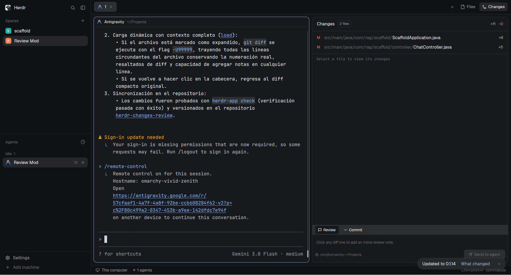

# herdr-files-search

An enhanced file browser and IntelliJ-style **Search Everywhere** mod for the [Herdr](https://github.com/herdr-app) desktop app.

It extends Herdr's native `files` panel with a magnifying glass search icon in the header that launches a floating search dialog supporting multi-tab searches across files and file contents (`All`, `Files`, `Text`), fuzzy filename matching, fast live grep search, keyboard navigation, and automatic file preview with parent directory expansion.



## Features

- **Files Panel Integration**: Preserves the complete native file tree, lazy folder loading, git status badges (`A`, `M`, `D`, `U`), and syntax-highlighted code preview.
- **Search Everywhere Overlay**: 
  - Floating dialog styled after IntelliJ's Search Everywhere window.
  - **`All`**: Unified search showing top file name matches and code content matches in one view.
  - **`Files`**: High-performance fuzzy search across all workspace files by name and relative path.
  - **`Text`**: Fast full-text grep search (`rg` / `git grep`) across repository contents with line numbers and highlighted code snippets.
- **Keyboard & Mouse Navigation**:
  - `Tab` / `Shift+Tab`: Cycle between `All`, `Files`, and `Text` tabs without leaving the keyboard.
  - `↑` / `↓` / `PageUp` / `PageDown`: Navigate search results with fixed-position virtual scrolling.
  - `Enter` / Click: Jump directly to the selected file, close the search window, expand its parent folders in the file tree, and open the code preview.
  - `Esc`: Close the search overlay.
- **Theme Adaptive**: Dynamically inherits theme colors (`popover`, `accent`, `raised`, `selected`, `dim`, `foreground`) from the active Herdr theme.

## Quick Install

Run this command in your terminal:

```bash
curl -fsSL https://raw.githubusercontent.com/JohnMunozR/herdr-files-search/main/install.sh | bash
```

Or clone the repository and run:

```bash
git clone https://github.com/JohnMunozR/herdr-files-search.git
cd herdr-files-search
bash install.sh
```

The script copies the mod into `~/.config/herdr-app/mods/files-search/`, verifies its syntax with `herdr-app check`, and updates your Herdr layouts (`main-copy.json`, etc.) to use `files-search` instead of `files`.

## Manual Installation

1. Copy the mod folder:
   ```bash
   mkdir -p ~/.config/herdr-app/mods/files-search
   cp -r mods/files-search/* ~/.config/herdr-app/mods/files-search/
   ```

2. Update your personal layout file in `~/.config/herdr-app/layouts/` (e.g. `main-copy.json`):
   ```json
   {
     "id": "files",
     "type": "block",
     "content": {
       "mod": "files-search"
     }
   }
   ```

3. Reload Herdr or switch layouts to see the new search button on the **Files** tab.

## License

[Apache-2.0](LICENSE) © [John Muñoz](https://github.com/JohnMunozR)
