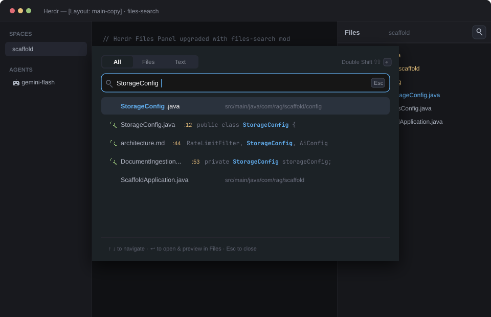

# files-search

An enhanced file browser and IntelliJ-style Search Everywhere mod for the Herdr desktop app. It extends Herdr's native Files panel with a magnifying glass button in the header that launches a floating search overlay with multi-tab search across files and code contents (`All`, `Files`, `Text`), fuzzy matching, live syntax-highlighted results, and instant file preview and tree expansion.

## What you see

- **Files Panel Header** (42px high, `border_b(1)` in `border`):
  - Left: Back arrow button `←` when a file preview is active.
  - "Files" title in `font_semibold()`.
  - Focused root folder name or active filename in `dim` (right-aligned).
  - Search button (`search.svg`, 26x26px, hover in `hover`, cursor pointer).
- **Files Tree** (`files-tree`, scrollable list):
  - Retains 100% of Herdr's native folder hierarchy, file icons, lazy directory traversal, and git status marks (`A`, `M`, `D`, `U`).
  - Clicking any file opens a syntax-highlighted, read-only preview using `EditorState`.
- **Search Everywhere Overlay** (`files-search-overlay`, 680px floating dialog, background `popover`, 12px rounded, 1px `border`, shadow):
  - **Segmented Tabs Bar**:
    - Tabs on the left: **`All`**, **`Files`**, **`Text`**. The active tab is highlighted with `background` and `foreground` text.
    - Right side: search status indicators ("Searching text…") and keyboard shortcut hint badge (`Tab to switch ⇥`).
  - **Search Input Bar** (38px high, rounded 8px, border in `accent`, background in `background`):
    - Search icon in `dim`.
    - Native `Input` element with auto-focus.
    - `Esc` badge to close the dialog.
  - **Results List**:
    - Fixed-height virtual scrolling supporting both keyboard (`↑`/`↓`/`PageUp`/`PageDown`/`Enter`) and mouse wheel.
    - **`Files` results**: File icon in `muted`, matched file name with fuzzy matching highlights in `ansi4` (accent), and full relative path in `dim`.
    - **`Text` results**: Search icon in `ansi4`, file name, line number pill (`:line` in `ansi3`), and the matching code snippet with the query highlighted in bold `ansi4`.
    - **`All` results**: Combined top matching files and top matching text occurrences.
    - Selected row highlighted with `selected` background.

## How it behaves

- **Triggering search**: Click the magnifying glass in the `Files` header or press the search shortcut.
- **Switching tabs**: Click **All**, **Files**, or **Text** tabs, or press `Tab` / `Shift+Tab` to cycle between them without leaving the keyboard.
- **Searching by name (`Files`)**: Fast indexing of repository files via `git ls-files` (or `rg --files` / `find`). Typing queries filters and ranks matching files using fuzzy scoring.
- **Searching by text (`Text`)**: Asynchronous, debounced full-text search across all workspace files using `rg` (or `git grep`), streaming up to 35 matches with line numbers and snippets while typing. Concurrency sequence guards prevent race conditions.
- **Combined search (`All`)**: Merges the top file matches and top content text occurrences in one unified view.
- **Navigation & Selection**:
  - `↑` and `↓` arrow keys move through results.
  - `Enter` or mouse click selects the item.
  - Selecting an item closes the overlay, notifies the main `Files` panel via `setShared("files-search.select", ...)`, automatically expands all parent folders in the file tree, and opens the file in the preview pane.
  - `Esc` closes the search overlay.

## Built from

- **Layout integration**: Replaces `{ "mod": "files" }` with `{ "mod": "files-search" }` in layouts (e.g., `main-copy.json`).
- **Keys integration**: Merges `"ctrl-p": "mod.open:files-search"` and `"alt-f": "mod.open:files-search"` into `keys.json` under `"global"`.
- **Mod files**:
  - `mods/files-search/main.js`: Dual-mode component (`Files` panel + `Search Everywhere` floating dialog).
  - `mods/files-search/mod.json`: Manifest declaring `files-search` as a clone of `files`.
  - `mods/files-search/file.svg`, `folder.svg`, `chevron-down.svg`, `chevron-right.svg`, `search.svg`: Self-contained vector icons.
